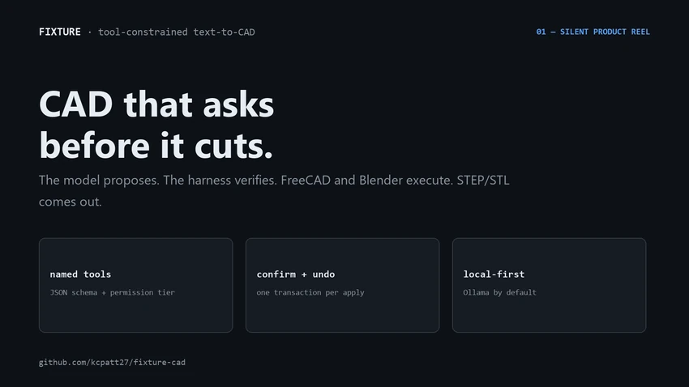
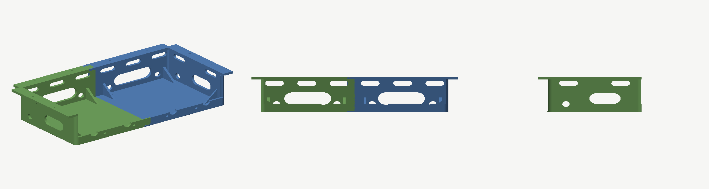
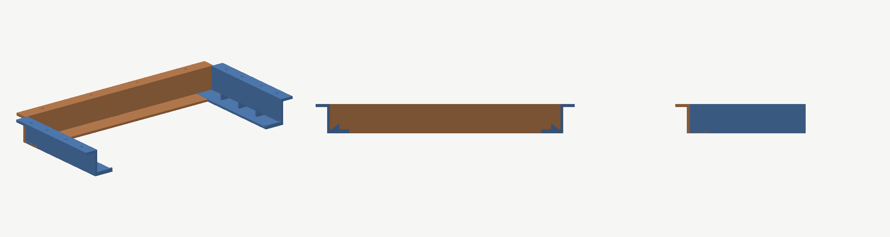

# Fixture

**Local-first, tool-constrained AI for CAD and mesh, with EDA next.**

[](https://github.com/kcpatt27/fixture-cad/actions/workflows/test.yml)
[](https://github.com/kcpatt27/fixture-cad/releases)
[](https://pypi.org/project/fixture-cad/)
[](LICENSE)

Fixture lets you chat-drive **FreeCAD** and **Blender** through one local
harness, with **KiCad** designed as the next consumer. The model proposes
**named tools**; the client confirms, executes, and undo-wraps them. Inference
defaults to **Ollama on localhost**, with an opt-in **OpenRouter** cloud lane for
quality comparisons.



*Silent product reel: plan → apply → STEP/STL. Asset notes in
[`docs/reel/README.md`](docs/reel/README.md); live walkthrough shot list in
[`docs/demos.md`](docs/demos.md). GIF copy for social posts:
[`docs/reel/fixture-reel.gif`](docs/reel/fixture-reel.gif).*

> **The model never runs arbitrary code.** Every mutation is a registered tool
> with a JSON schema, a permission tier, and an undo transaction (ADR-001).
> `python` actions are stripped before they reach a client.

## What ships in v0.2.0

| Component | What it is |
|---|---|
| `harness/` | FastAPI service on `:8766`: schema validation, prompt assembly, intent gate, sanitization, provider lanes |
| `clients/freecad_workbench/` | FreeCAD dock with document context, named runners, per-apply undo, and smoke suites |
| `clients/blender_addon/` | Blender N-panel with mesh runners, including `clean_mesh` and `clean_scan` (scan → watertight STL) |
| `benchmark/` | 60-case planner bench across FreeCAD and Blender, plus a pinned competitor head-to-head |
| `designs/desk-mounts/` | Two scripted-CAD cases exported to STEP/STL with print specs |
| `docs/` | Wire contract, tool schemas, safety evidence, design notes, research |

Published as `fixture-cad` on PyPI (wheel + sdist), Apache-2.0.
Wire protocol `0.1.0`; package `0.2.0`. Snapshot: 2026-11-06.

## How it works

```
FreeCAD dock / Blender N-panel
        │  POST /chat {app, version, context, message, mode, model_lane}
        ▼
Harness :8766 — schema validate → prompt (Ollama | OpenRouter)
                 → sanitize → intent gate → need_confirm
        │  {reply_text, actions[tool_call|meta], intent_status, supported_scope}
        ▼
Client — Apply/Cancel → named runners with undo → one optional repair POST
```

Clients own document state and execution; the harness never holds a CAD
document. Intent statuses (`supported` / `ambiguous` / `partial` /
`unsupported`) make the assistant ask or refuse instead of overclaiming, and
every apply is one undoable transaction.

## What it produces




Two scripted **desk mounts**: a four-piece laptop cradle and a two-piece
under-desk shelf. Both are generated by `designs/desk-mounts/desk_mounts.py`
under FreeCAD 1.1 headless, exported to STEP/STL, and rendered from the exported
STLs by `designs/desk-mounts/stl_render.py`. Each has a print spec under
`designs/`. The geometry is scripted CAD, not model-generated; the generator is
the source of truth.

## Benchmark

The planner runs a 60-case suite across FreeCAD and Blender. In a single-turn
head-to-head against the closest open-source CAD assistant, using the same four
cloud models and a shared case set:

| Model | Fixture case pass | freecad-ai case pass |
|---|---:|---:|
| `deepseek/deepseek-v4.1-flash` | 98.3% | 63.8% |
| `deepseek/deepseek-v4-pro` | 98.3% | 57.6% |
| `z-ai/glm-5.3-flash` | 96.7% | 74.6% |
| `google/gemini-3.8-flash` | 98.3% | 69.0% |
| **Average** | **97.9%** | **66.3%** |

**+31.7 points** average across the four models. The planner-floor ladder puts a
local 4B model at **97.2%** against **99.8%** for the cloud lane — within three
points of the frontier lane.

Method, rubric asymmetry, and failure analysis:
[`benchmark/headtohead-vs-freecad-ai.md`](benchmark/headtohead-vs-freecad-ai.md).
The cases, scorer, and pinned competitor commit are in `benchmark/`; raw
captures are not published, since the method is reproducible without them.

## Quick start

```powershell
# Prerequisites: Python 3.11+, Ollama on :11434 with a model pulled,
#                FreeCAD 1.0+ / Blender 5.2 (optional, for the clients)

# Terminal 1 - harness
pip install fixture-cad          # or: pip install -e harness
python -m uvicorn fixture_cad.main:app --host 127.0.0.1 --port 8766
# → http://127.0.0.1:8766/health

# Terminal 2 - from the repo root: one-command verification gate
python harness/scripts/verify_fast.py

# Planner benchmark (no CAD GUI required)
cd benchmark
python -m fixture_bench run --models-file benchmark/models.txt
python -m fixture_bench report --latest

# Clients
#   FreeCAD 1.1: junction clients/freecad_workbench into %APPDATA%\FreeCAD\v1-1\Mod\
#   (earlier versions use %APPDATA%\FreeCAD\Mod\; check your version)
#   Blender: install clients/blender_addon/fixture_blender as an addon
```

The harness binds to localhost only. It is not a sandbox — save your document
before unusually heavy operations.

### Optional cloud lane

See ADR-010. Prompts and context metadata leave the machine only when this lane
is enabled; the default remains a local Ollama tag.

```powershell
$env:FIXTURE_OPENROUTER_API_KEY = "sk-or-..."
$env:FIXTURE_ACCURATE_MODEL = "openrouter:deepseek/deepseek-v4.1-flash"
```

Or put the key in a gitignored `.env` at the repo root (copy `.env.example`);
real environment variables win.

## Verification

The release tree was gated on 2026-11-06. Evidence:
[`docs/SAFETY-2026-11-02.md`](docs/SAFETY-2026-11-02.md).

| Check | Result | Run |
|---|---|---|
| Fixtures + pytest | 140 passed | `20261106T125738Z` |
| FreeCAD smokes (7 scripts) | 92 / 0 | `20261106T125738Z` |
| Blender smokes (4 scripts) | 29 / 0 | `20261106T132007Z` |
| `/health` | 200, local model, cloud unconfigured | release tree |

CI runs the headless pytest suite. The FreeCAD and Blender Path B smokes are
local because they need the applications installed; their run ids are published
rather than their output.

## Repository layout

| Path | Role |
|---|---|
| `harness/` | FastAPI service on `:8766` (providers, planner, registry) |
| `clients/freecad_workbench/` | FreeCAD dock, context, runners, undo, smokes |
| `clients/blender_addon/` | Blender N-panel, operators, mesh runners, smokes |
| `benchmark/` | Path A planner bench: cases, `models.txt`, results |
| `designs/desk-mounts/` | Two public scripted-CAD cases (STEP + STL + print specs) |
| `docs/` | Contracts, schemas, tool registry, safety evidence, research |
| `.github/workflows/` | Headless pytest CI |

## Scope

Fixture is deliberately narrow. It is not a code-generation tool, not a FreeCAD
fork, and not an Onshape-style UI. It does not yet cover FEM, assemblies,
TechDraw, or DXF — the ladder is in [`ROADMAP.md`](ROADMAP.md). Image-to-CAD is
out of scope: raster references are metadata-only and fail closed before the
planner, with no vision lane.

That last guarantee is structural, not documentary. A non-SVG reference image
is treated as metadata, and any `import_svg_sketch` call is stripped from the
action tree — including indirect and nested calls — during both argument
alignment and sanitization, so a repair re-emission cannot smuggle it back. Each
strip is reported as a sanitize warning.

**KiCad** is the next consumer: action plugin, named PCB tools, board-snapshot
undo, DRC before Gerber export. The proposal and its evaluation plan are in
[`docs/kicad-consumer.md`](docs/kicad-consumer.md). No KiCad code ships yet.

## Known gaps

- The manual FreeCAD GUI soak is still open; Path B smokes run headless.
- Tool reranking is implemented but unmeasured.
- The head-to-head measures the competitor's planner turn, not its full
  multi-turn loop.
- BlenderLore is identified as an evaluation target but not cloned.
- The Taiga-S1 executor experiment reached 3/3 desk goals at IoU 1.0000 (7/8 on
  the vocabulary-matched set) but is not a shipped runner.

## Documentation

| Doc | Covers |
|---|---|
| [`ROADMAP.md`](ROADMAP.md) | Plan, ladder, and the current frontier |
| [`ARCHITECTURE.md`](ARCHITECTURE.md) | Design and as-built truth (stubs labelled) |
| [`DECISIONS.md`](DECISIONS.md) | Append-only ADR log |
| [`PROJECT_CONTEXT.md`](PROJECT_CONTEXT.md) | Stable map, environment, conventions, glossary |
| [`docs/api-contract.md`](docs/api-contract.md) | Authoritative wire shapes and schemas |
| [`docs/harness.md`](docs/harness.md) | Provider, lane, and environment reference |
| [`docs/reel/README.md`](docs/reel/README.md) | Product reel and social preview assets |
| [`docs/demos.md`](docs/demos.md) | Live walkthrough shot list |
| [`docs/kicad-consumer.md`](docs/kicad-consumer.md) | KiCad as the next consumer (proposal) |
| [`docs/research/`](docs/research/) | Competitor audit and data strategy |
| [`docs/SAFETY-2026-11-02.md`](docs/SAFETY-2026-11-02.md) | Public-release gate evidence |

Reading order: `PROJECT_CONTEXT` → `ARCHITECTURE` → `ROADMAP` → `DECISIONS`.

## Naming

| Thing | Name |
|---|---|
| Brand | **Fixture** |
| Repo / PyPI distribution | `fixture-cad` |
| Python import | `fixture_cad` |
| CLI | `fixture` |
| FreeCAD workbench package | `fixture` |
| Blender addon | `fixture_blender` |
| Benchmark | `fixture_bench` |
| Environment variables | `FIXTURE_*` |

## Contributing

Solo project; issues and focused pull requests are welcome. The gate is
`python harness/scripts/verify_fast.py` with the harness running, and docs
update in the same change as the code. See [`CONTRIBUTING.md`](CONTRIBUTING.md).

## License

Apache-2.0. See [`LICENSE`](LICENSE) and [`NOTICE`](NOTICE).
