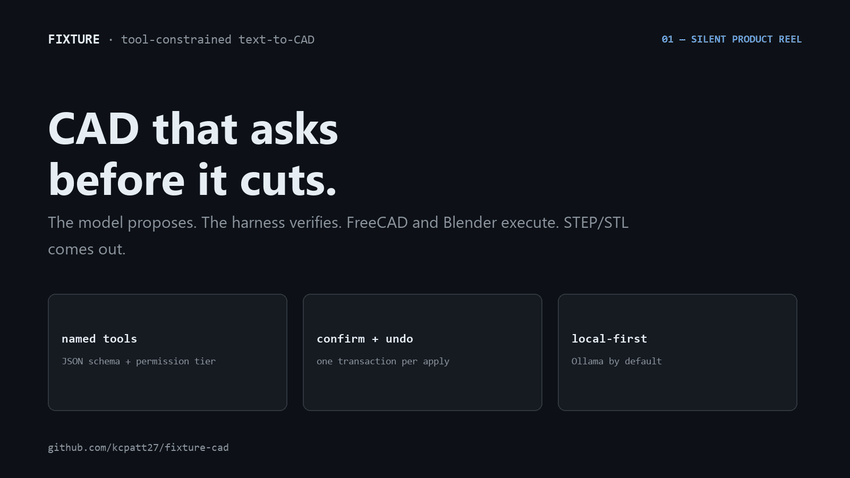

# Product reel



*Eight cards, roughly 20 seconds, looping. Built from scripted-CAD renders and
measured numbers — no mock UI, no composited screenshots.*

Fixture is a local-first harness that lets an LLM drive **FreeCAD** and
**Blender** through named tools instead of generated code. The reel walks the
contract that follows from that decision.

## What the reel shows

| # | Card | The point |
|---|---|---|
| 1 | The loop | The model proposes, the harness verifies, FreeCAD or Blender executes, STEP/STL comes out. |
| 2 | No arbitrary code | Every mutation is a named tool with a JSON schema, a permission tier, and an undo transaction. `python` actions are stripped and never execute. |
| 3 | Plan, then apply | The full plan is visible before anything runs: apply or cancel, one undo per apply, one repair pass if the plan is wrong. |
| 4 | Under-desk shelf | A real part: two mirror halves, half-lap joint, cable ports, magnet pockets, exported to STEP/STL with a print spec. |
| 5 | Laptop cradle | A second real part: four printed pieces, measured slide-in height, 30 mm rear ledge. |
| 6 | The limits | No arbitrary code, no cloud by default, no unmeasured claims. KiCad is a proposal, not shipped code. |
| 7 | Measured | Four-model head-to-head against `freecad-ai`: **97.9% vs 66.3%** average case pass (ranges 96.7–98.3% vs 57.6–74.6%), and the current verification gate. |
| 8 | The project | Local-first, tool-constrained, measured. |

## Why it is generated

The reel is produced by [`make_reel.py`](make_reel.py) rather than recorded. That
keeps three properties that a screen capture would not:

- **It cannot drift from the evidence.** The gate figures come from
  `GATE_ID` / `GATE_METRICS`; the benchmark figures match the table in the
  repository `README.md`.
- **It leaks nothing.** No private design assets, no local paths, no keyboard
  render, no machine identifiers.
- **It is reproducible.** Images and fonts are the only inputs; Pillow is the
  only dependency.

The renders are the exported assemblies from `designs/desk-mounts/`, read
straight from disk. Nothing in the reel is a mock-up: the parts exist, the
numbers have run ids, and the cards that state a limitation say so plainly.

A live walkthrough is planned and will be recorded separately; the shot list
lives in [`docs/demos.md`](../demos.md).

## Figures used

| Figure | Value | Maintained in |
|---|---|---|
| Verification gate | pytest 140 · FreeCAD 92/0 · Blender 29/0 | `GATE_ID`, `PYTEST_COUNT`, `FREECAD_SMOKES`, `BLENDER_SMOKES` |
| Head-to-head, 4-model average | 97.9% vs 66.3% | `build_social_preview()`, benchmark table in `README.md` |
| Head-to-head, per-model range | 96.7–98.3% vs 57.6–74.6% | `card_bench()` |
| Local vs cloud lane | Local 4B model 97.2% · cloud 99.8% | `build_social_preview()`, planner-floor ladder in `README.md` |

Update these constants after re-running `python harness/scripts/verify_fast.py`,
in the same change as the README status line. A pending number is never a
claimed number.

## Social preview

[`docs/social-preview.png`](../social-preview.png) is the 1280×640 GitHub social
card — the image shown in link previews and on the repository's social slot. It
carries the same palette and the same two proof numbers as the reel.

GitHub does not read it from the repository: upload it under **Settings →
General → Social preview** after the repository is public, replacing any older
image.

## Regenerate

```powershell
# Reel (GIF)
python docs/reel/make_reel.py

# Social card (PNG)
python docs/reel/make_reel.py --social-preview
```

Requires Python 3.11+ and Pillow. No ffmpeg. Fonts are discovered from standard
Windows, macOS, and Linux locations with a Pillow fallback, so glyph metrics —
and therefore exact bytes — vary between machines; regenerate on the platform you
are publishing from when byte stability matters.

Output is checked in, so a fresh clone shows the reel without running anything.
Do not hand-edit `fixture-reel.gif` or `social-preview.png`; the next generator
run overwrites both. Background is `#0d1117`.

### Checks after regenerating

```powershell
python -c "from PIL import Image; print(Image.open('docs/reel/fixture-reel.gif').size)"
# (850, 478)

python -c "from PIL import Image; print(Image.open('docs/social-preview.png').size)"
# (1280, 640)
```

Then confirm the GIF still animates (8 frames, 2.5 s each, infinite loop) and
that the card is legible at thumbnail size: headline, both proof numbers, and the
repository URL.

### Editing the cards

Card text lives in one function per card in `make_reel.py` (`card_title()`,
`card_no_code()`, `card_apply()`, `card_render()`, `card_not()`, `card_bench()`,
`card_end()`), with the social card in `build_social_preview()`. Each
`d.text(...)` or `_text_block(...)` call is one element: edit the string to
change it, resize with the nearby `_font(..., size)` value, and close the gap in
the following `y` values when a section is removed.
